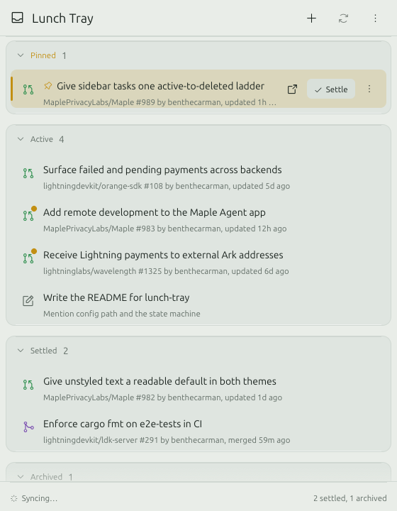
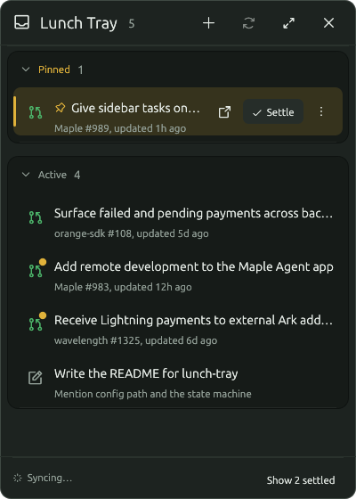

# Lunch Tray

A system tray todo list for Ubuntu. It follows your pull requests and issues
on GitHub, lets you add your own tasks, and lets you settle, archive, and
delete them. The tasks live on a Cloudflare Worker, which syncs with GitHub
and serves them to AI assistants over MCP, so both stay online while your
computer is off. The app is written in Rust with egui and a
StatusNotifierItem tray icon.




## Features

- Tray icon. Left click opens a compact popover with the pinned and active
  tasks. Right click shows a short native menu: open, add, sync, quit. A badge
  on the icon shows new activity or a sync error.
- Full window with Pinned, Active, Settled, and Archived sections.
- GitHub sync, run by the Worker every two minutes. New open items become
  tasks. Closed or merged items settle on their own. New activity on a
  settled item wakes it.
- CI results and merge state on open pull requests: passed over total
  checks, and a warning when the branch conflicts with its base. Active
  tasks are polled when the result is missing, stale, still running, or
  the pull request moved. Settled and archived tasks keep their last badge
  until they come back.
- Light on GitHub's rate limit: searches send the last ETag, so an
  unchanged answer costs nothing; the quota headers are read on every
  answer and optional work waits when the last tenth is left; a
  rate-limit answer pauses the sync until the time GitHub gives.
- Changes show at once: the Worker pushes them to the app over a WebSocket.
  The app keeps a copy of the tasks for a start without network.
- An MCP server on the Worker, so AI assistants can read and change the
  tasks.
- Manual tasks with notes and a link.
- The window is a tray: a mint-grey melamine surface with a recessed
  compartment per section, and mustard for the few things that need
  attention. Light and dark mode share the palette, so both read as the same
  design. Follows the system through the desktop portal, or set it in the
  window menu.
- Uses the desktop's Ubuntu font when installed and Phosphor icons.

## Build and install

Lunch Tray has two parts: the Worker, which keeps the tasks, and this app,
which shows them. Set up the Worker first; see
[worker/README.md](worker/README.md). It fits in the Workers Free plan.

The app requires Rust 1.95 or newer (`rust-toolchain.toml` pins 1.96.1). No
system development headers are needed.

```sh
git clone https://github.com/benthecarman/lunch-tray
cd lunch-tray
cargo install --path . --locked
```

That puts `lunch-tray` in `~/.cargo/bin`. To run it as a user service that
starts with your desktop session and lives in the tray:

```sh
install -Dm644 assets/lunch-tray.service ~/.config/systemd/user/lunch-tray.service
systemctl --user daemon-reload
systemctl --user enable --now lunch-tray.service
```

Useful afterwards:

```sh
systemctl --user status lunch-tray     # state and recent log
journalctl --user -u lunch-tray -f     # follow the log
systemctl --user reload lunch-tray     # ask the Worker to sync now (sends SIGHUP)
systemctl --user restart lunch-tray    # pick up config changes
```

The unit is `Type=notify`: the app reports ready once its tray and its link
to the Worker are up, stops cleanly on SIGTERM, and is restarted on failure.
If it starts before the shell's tray host, it waits and registers when the
host appears.

For an entry in the app grid that opens the full window, with its icon:

```sh
lunch-tray --export-icons ~/.local/share/icons/hicolor
install -Dm644 assets/lunch-tray.desktop ~/.local/share/applications/lunch-tray.desktop
```

GNOME needs the AppIndicator extension for tray icons. Ubuntu ships it enabled.

## Run

```sh
lunch-tray            # open the full window and the tray icon
lunch-tray --hidden   # tray icon only
lunch-tray --popover  # open the compact popover
```

Opening a window that is already open brings it to the front, even when
it is minimized. The tray host passes an activation token with each click,
and the app hands it to the compositor for its window. Without a token,
Wayland may refuse the focus request, and the window then reopens itself,
which does land on top.

Left-click the tray icon to toggle the popover. It closes when the pointer
has been inside it and focus moves elsewhere, on Escape, or with its close
button. The expand button in its header opens the full window. Closing any
window keeps the app in the tray. Quit from the tray menu or the window
menu.

Wayland does not let an app choose where its windows appear, so GNOME places
the popover like any new window, usually centered. It can be dragged by its
header.

## Configuration

The first run writes `~/.config/lunch-tray/config.toml`. Point it at your
Worker:

```toml
[remote]
url = "https://lunch-tray.<your-subdomain>.workers.dev"
token = "..."    # the Worker's API_TOKEN, or token_env
```

The sync settings live on the Worker, under `[vars]` in
`worker/wrangler.toml`: the poll interval, where closed items go
(`ON_CLOSE`), CI checks, the GitHub searches, and repositories to ignore
(`GITHUB_EXCLUDE`, as `owner/repo` or `owner/*`). Items from an ignored
repository are never added, and tasks already tracked from one are archived
on the next sync.

The app keeps its copy of the tasks, and its own theme and "show archived"
settings, in `~/.local/share/lunch-tray/remote-cache.json`. To load a task
file into an empty Worker, such as that copy or a `tasks.json` from an older
version, run `lunch-tray --upload FILE`.

## MCP server

The Worker gives AI assistants the task list as MCP tools: list, get, add,
update, move, and delete tasks, mark them as read, sync now, and show the
status. The endpoint is `https://lunch-tray.<your-subdomain>.workers.dev/mcp`,
behind the same `API_TOKEN`:

```sh
claude mcp add --transport http lunch-tray https://lunch-tray.<your-subdomain>.workers.dev/mcp \
  --header "Authorization: Bearer <API_TOKEN>"
```

It uses the Streamable HTTP transport of MCP revision 2026-07-28:
stateless, with `server/discover` and no `initialize` handshake. Clients on
the 2025 revisions also work. Their `initialize` gets an answer, and the
server never issues a session id. Each response is a single JSON object;
nothing streams.

## The state machine

A task has one `state` field: `active`, `settled`, or `archived`. Deleted
tasks are removed. A `pinned` flag puts an active task in the
Pinned section. Every section sorts by last activity, newest first: the
remote item's update time, or the task's own for manual ones.

Where a row shows, evaluated in order: archived, then pinned, then the state.

| From | Hover button | Menu |
|---|---|---|
| Active or Pinned | Settle | Rename, Pin or Unpin, Settle, Archive, Delete |
| Settled | Archive | Rename, Reopen, Archive, Delete |
| Archived | Delete | Rename, Reopen, Delete |

- **Settle** drops the pin. Settling a settled task does nothing.
- **Reopen** moves the task back to Active. It never restores a pin.
- **Archive** keeps everything else as it is. Archiving an archived task does
  nothing. An archived task with an open remote item wakes on new activity.
- **Mark all as read**, in the window menu, clears the new-activity dot on
  every task and the badge on the tray icon.
- **Archive older than a year**, in the window menu, archives every unpinned
  task whose item has not moved in a year, after asking. They come back on
  activity like any archived task.
- **Delete** asks first. Enter confirms, Escape or the backdrop cancels. While
  the dialog is open, no other keys do anything.

A task whose remote item is open is "running". Running tasks can be settled
and archived, so a stale pull request can be put away. It comes back to
Active as soon as something happens on it. Running tasks cannot be deleted,
since the next sync would bring the item back; the store shows that as a
notice. Once the item is closed or merged, delete works too.

Sync applies these rules to tracked items:

- open, not tracked: new Active task
- open to closed or merged: an Active task settles, or goes to Archived
  when the Worker has `ON_CLOSE = "archive"` (a Settled task moves too)
- closed to open: a Settled or Archived task reopens
- open but no longer in any of your queries, for example after you submit
  a review: an Active task settles. Pinned tasks stay.
- back in your queries, for example a review requested again: a Settled or
  Archived task wakes into Active
- open with newer activity: a Settled or Archived task wakes into Active

## Keys

Click a row to open its pull request or issue in the browser. A note with a
link opens the link; one without opens its editor. Hover a row for its
actions.

The search field under the header filters every section by org, repo, title,
or number. Each word must match somewhere, so `ldk 291` finds ldk-server
#291. A search also looks through the archive.

| Key | Action |
|---|---|
| `/` or Ctrl+F | Focus the search field |
| Escape | Clear the search, then close the popover |

## Development

```sh
cargo test --workspace
cargo clippy --workspace --all-targets
LUNCH_TRAY_SCREENSHOT=/tmp/shot.png cargo run   # saves the window and quits
```

The task model, the sync, and the MCP handler live in `crates/core`, shared
by the app and the Worker in `worker/`, which builds on its own for wasm.
See [worker/README.md](worker/README.md) to run the Worker locally.

## License

MIT. See `LICENSE`.
